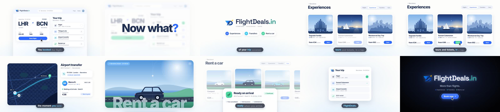
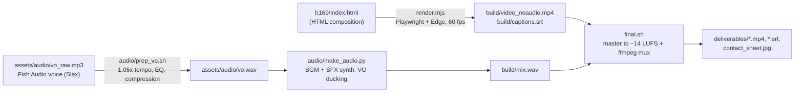

# FlightDeals "Now what?" Ad

**A 16:9 motion-graphics ad for FlightDeals.in, built in code.**

AI-assisted brand ad for FlightDeals.in, created using Claude Opus 5.5 with motion graphics and visual storytelling to showcase the travel platform.

A 21-second video ad for [FlightDeals.in](https://flightdeals.in/) promoting **Experiences, Transfers and Rent a car**. It opens on the moment right after you book a flight ("You booked the flight. Now what?") and shows FlightDeals covering the rest of the trip. Everything is built in code: an HTML/CSS/JS composition is rendered frame by frame to video, the music and sound effects are synthesized from scratch, and the voiceover comes from Fish Audio.



## Deliverables

| File | Format | Length | Story | Voice |
| --- | --- | --- | --- | --- |
| `deliverables/FlightDeals_16x9_NowWhat.mp4` | 1920×1080, 60 fps, H.264 + AAC 256 kbps, −14 LUFS (peak −1.6 dB) | 21.2 s | "Now what?": a booked flight with an empty trip plan → brand drop → Experiences → Transfers → Rent a car → every trip item ticked → "More than flights. Book now." | Slax (Fish Audio) |
| `deliverables/FlightDeals_16x9_NowWhat.srt` | SubRip captions, 8 cues | 21.2 s | Same script, for platforms that take a separate caption file | |
| `deliverables/contact_sheet.jpg` | 10 frames | | Quick visual check of the final file | |

Captions are also burned into the video word by word, so it works with the sound off. The file is ready for YouTube in-stream, the Meta feed (16:9), LinkedIn and X. The full creative brief, script, storyboard, sound design and claims check are in [`FlightDeals_Ad_Brief.md`](FlightDeals_Ad_Brief.md).

> The final MP4 is stored with **Git LFS**, the same as in `flightdeals-ad-studio`. It's only about 11 MB, but this keeps both repos consistent. See [`GIT_FIRST_COMMIT.md`](GIT_FIRST_COMMIT.md).

## How it works



- **Deterministic animation.** The composition exposes `window.seek(t)`, and every element's position, scale, blur and opacity is a pure function of time. The helpers are keyframes (`kf`), tweens (`tw`), a closed-form `spring` and `bump`, plus a seeded `hash` instead of `Math.random`. The renderer seeks each frame, takes a PNG screenshot and pipes it to ffmpeg (libx264, CRF 15, yuv420p), so a frame always renders the same way.
- **Motion language.** The style comes from an Apple-keynote reference: soft white and bright blue, glassy surfaces, and no frozen frames. Every shot enters already moving, with an exponential ease-out, and leaves on an accelerating whip or a blur ramp. Directional blur follows the motion. Each feature opens on a hero card with a **frosted-glass title** (a blurred, lightened copy of the illustration clipped to the letters), which then shrinks into the live app UI. A cursor taps through each feature, and captions highlight word by word.
- **Audio.** The music is in D major at 120 BPM. It drops on the brand reveal at 3.25 s, and every scene cut lands on a beat (6.25, 9.75, 13.25, 17.25 and 18.25 s). It's built from a pad, a pluck arpeggio with ping-pong delay, a four-on-the-floor kick with sidechain pump, and a sub bass. About 40 synthesized sound effects (clicks, chimes, whooshes, impacts, risers, pops) are cued to visual events. The music ducks under the voice, sitting about 10–11 LU below it, and the master is −14 LUFS / −1 dBTP.

### Timeline

| Time (s) | Scene | Voiceover |
| --- | --- | --- |
| 0.00–3.25 | **Hook.** An app window rises out of a blue haze. A cursor clicks "Book flight", which turns into "Booked ✓". The three empty trip slots pulse "?", then "Now what?" slams in and the scene whips up. | "You booked the flight. Now what?" |
| 3.25–6.25 | **Brand drop.** On the beat, the FD logo appears with four tiles orbiting it. They settle into the FlightDeals.in lockup ("COMPARE · DISCOVER · SAVE") above three feature pills. | "FlightDeals has the rest of your trip covered." |
| 6.25–9.75 | **Experiences.** A glass-title hero card shrinks into a grid of three tour cards. The cursor taps "Book" on the catamaran, which turns into "Booked ✓" with a toast. | "Experiences: tours and tickets, in a tap." |
| 9.75–13.25 | **Transfers.** A map hero shrinks into a route view. A driver card rises ("Waiting at Arrivals · Gate B") and the flight status flips to "Landed". | "Transfers: a ride waiting the moment you land." |
| 13.25–17.25 | **Rent a car.** A road-scene hero shrinks into a car carousel. The cursor selects the SUV and a "Ready on arrival" sheet rises. | "Rent a car: the right wheels, ready when you arrive." |
| 17.25–18.25 | **Payoff.** The trip card returns with all four items ticked. | "FlightDeals." |
| 18.25–21.20 | **End card.** The glowing FlightDeals.in lockup, "More than flights.", the three feature dots, and a "Book now" button that gets clicked. | "More than flights. Book now." |

## Project structure

```
.
├── README.md                  ← you are here
├── GIT_FIRST_COMMIT.md        ← step-by-step: first commit + push to GitHub
├── FlightDeals_Ad_Brief.md    ← brief, hook, script, storyboard, sound design, claims check
├── package.json               ← Node dependency (playwright-core) + npm scripts
├── render.mjs                 ← frame-accurate renderer (seek → screenshot → ffmpeg), also renders stills
├── final.sh                   ← render, mix, master to −14 LUFS, mux, copy to deliverables/
├── h169/index.html            ← the 16:9 composition: scenes, timings, captions, SVG illustrations
├── audio/
│   ├── prep_vo.sh             ← Fish Audio take → mix-ready vo.wav (1.05x tempo, EQ, compression)
│   └── make_audio.py          ← BGM + SFX synthesis, VO placement + ducking, mix + stems
├── tools/
│   ├── analyze_vo.py          ← prints the speech segments (used to time captions and cuts)
│   └── key_logo.py            ← removes the white background from the official logo
├── assets/
│   ├── img/                   ← logo512.png (official, from flightdeals.in) + fd-mark.png (transparent cut-out)
│   └── audio/                 ← vo_raw.mp3 (Fish Audio original) + vo.wav (processed take used in the mix)
└── deliverables/              ← final ad (Git LFS), captions, contact sheet
```

These aren't in Git because the scripts rebuild them: `node_modules/` and `build/` (render, mix, master, stems, stills, logs).

## Requirements

- **Node.js 18+**, then run `npm install`. It installs `playwright-core`; no browser download is needed.
- **Microsoft Edge**. `render.mjs` uses `channel: 'msedge'`; change it to `'chrome'` to use Google Chrome.
- **ffmpeg** on your PATH
- **Python 3.10+** with `numpy scipy pillow`
- **Git Bash** to run the `.sh` scripts on Windows
- **Internet access while rendering**, because Inter and Space Grotesk load from Google Fonts

```bash
npm install
```

```bash
pip install numpy scipy pillow
```

## Rebuild the ad

1. Full rebuild: render the video, build the soundtrack, master, mux and copy everything to `deliverables/`. This takes about 8 minutes on an 8 GB laptop (1,272 frames at about 3 fps):

   ```bash
   npm run render
   ```

2. Audio-only changes, such as moving an SFX cue or changing the mix. This reuses `build/video_noaudio.mp4` and takes about a minute:

   ```bash
   npm run remix
   ```

3. Optional: re-process the voice from the original Fish Audio take:

   ```bash
   npm run vo
   ```

4. QA stills go to `build/stills/`. You can render the preset list or pick your own times:

   ```bash
   npm run stills
   ```

   ```bash
   node render.mjs stills 9.35 20.7
   ```

5. Live preview: open `h169/index.html?play=1` in Edge or Chrome for a looping playback. Use `h169/index.html?t=12.95` to jump to one frame.

## Editing tips

- **Scene timings** are in the `SCENES` list at the bottom of `h169/index.html` (`[id, start, end, fn]`). Each `S1()`…`S7()` animates on its own local time `u`, which starts at 0 when the scene starts.
- **Captions** are the `SEGS` list. Times are in voice-file seconds; the voice sits at +0.25 s on the timeline (the `VO` constant). A `0` flag keeps a line out of the burned-in captions, which is used where the same words are already big on screen ("Now what?", the feature names, the end card). The `.srt` text is the list inside `getSRT()`.
- **Voice placement.** The voice is one continuous take placed at 0.25 s (`put(vo_bus, vo, 0.25)` in `audio/make_audio.py`). Scene cuts sit on the beat just before each line. If you regenerate the voice, run `python tools/analyze_vo.py assets/audio/vo.wav` and update `SEGS`.
- **SFX cues** are the `put(sfx, …)` lines in `audio/make_audio.py`, grouped by scene. Keep them in sync with visual events.
- **Music**: `PROG` holds the chord changes, `DROP = 3.25`, `BEAT = 0.5` (120 BPM) and `END = 18.25` (the end card).
- **Mix**: duck depth 0.55, music gain 0.24, SFX gain 0.42. Measured during speech: voice ≈ −15.4 LUFS, music ≈ −26 LUFS, SFX −22 to −30 LUFS.
- **Brand**: the logo is `assets/img/fd-mark.png`. The wordmark (`.wm` class) is Space Grotesk 600: "FlightDeals" plus ".in" in teal `#239587`, with "COMPARE · DISCOVER · SAVE" underneath. The UI palette is navy `#1E2F52`, blue `#2F6BFF`, cyan `#3CC8F0`, mint `#4ED6A0` and page `#FDFDFB`.
- **Placeholder content** includes the London → Barcelona trip, flight FD 1204, prices in €, the tours, the driver "Marco R." and the number plate. All of it is illustrative. Read the claims check in the brief before running the ad.

## Known gotchas

- Inter's glyphs have overlapping contours, so an SVG stroke on the big glass titles drew lines inside the letters. The bright rim is drawn with a filter instead (erode the text's alpha and subtract it), which only outlines the outer edge.
- The logo `` has to finish loading before the first frame is captured. `init()` waits for every image after building the page and logs `LOGO FAILED TO LOAD` if one is missing.
- On an 8 GB machine with other apps open, Python hit memory errors (`OpenBLAS … Memory allocation`, `WinError 1450`). `audio/make_audio.py` limits BLAS to one thread. Don't run the audio script while the video render is running, and close heavy apps if it still fails.
- The glass titles resize to fit after the fonts load (`fitGlass`), so changing a title text doesn't need manual sizing.

## Credits & licensing

- **Brand and logo** (the FD mark and the FlightDeals.in wordmark) belong to FlightDeals.in. The logo is the official `https://flightdeals.in/logo512.png`, with the white background removed by `tools/key_logo.py`.
- **Fonts**: Inter and Space Grotesk (SIL Open Font License), loaded from Google Fonts.
- **Icons**: paths from Lucide (ISC License).
- **Illustrations**: the sea, Sagrada Família, Montserrat, map and road scenes and the cars are drawn in SVG in this repo.
- **Voiceover**: Fish Audio TTS with the voice "Slax".
- **Music and SFX**: original, synthesized in this repo, so they are royalty-free for this ad.
- **Motion reference**: the "Frame by Frame launch video" by @notdwd on [Prompt Motion](https://prompt-motion.com/notdwd-7de38a).
- No open-source license is included, so all rights are reserved by default.
